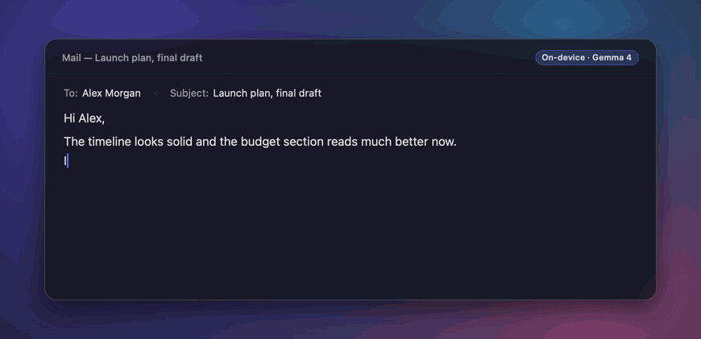
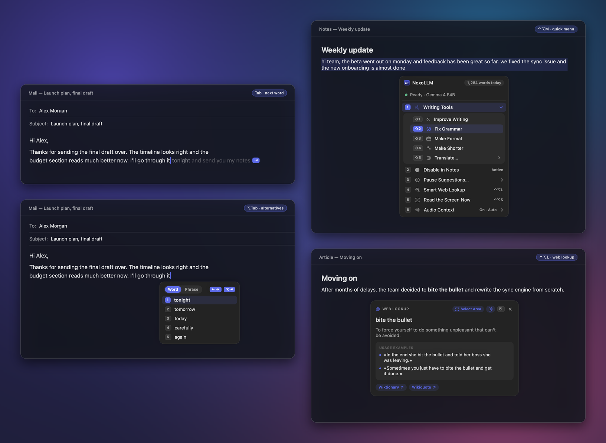
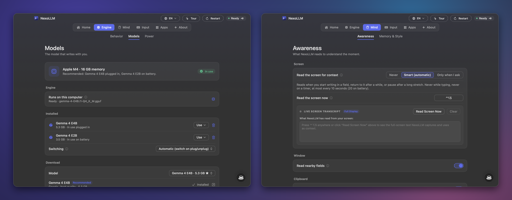
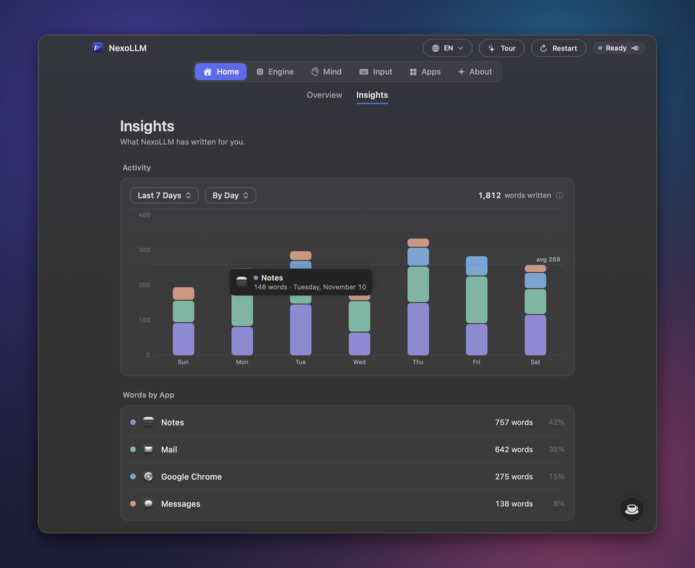

<h1 align="center">NexoLLM</h1>

Inline autocomplete, writing tools and instant answers for every app on your computer. 100% on-device AI. Private, open source, and out of your way.

  <a href="https://github.com/edevscomp/NexoLLM/releases/latest">Download</a> ·
  <a href="#install">Install</a> ·
  <a href="#shortcuts">Shortcuts</a>

## What it does

NexoLLM sits quietly in the background and suggests the rest of your sentence in grey, right after the cursor, in whatever app you are typing in — mail, chat, notes, documents, editors or the browser.

<kbd>Tab</kbd> accepts the next word so you stay in control of where a sentence turns; <kbd>⇧Tab</kbd> accepts the whole phrase; keep typing and the suggestion disappears without stealing focus. Punctuation takes its own step, and obvious typos get a single-key fix.

- **Alternatives (`⌥Tab`)** — lists other words for the one under your cursor; press again (or use <kbd>←</kbd> <kbd>→</kbd>) to switch between single words and full ways to finish the sentence.
- **Quick Menu & Writing Tools (`⌃⌥M`)** — opens right at the caret, driven entirely from the keyboard. Improve writing, fix grammar, make formal, shorten or translate in place across **six active languages** (`English`, `Italiano`, `Español`, `Français`, `Deutsch`, `Português`).
- **Smart Web Lookup (`⌃⌥L`)** — highlight an idiom, term or question anywhere to get a concise local summary with usage examples and linked sources from Wikipedia, Wiktionary, Wikiquote and news headlines.

## Context, models and privacy

Every suggestion, rewrite, translation and summary is computed on your own GPU and CPU using **llama.cpp** and **whisper.cpp**. There is no account, no subscription and no cloud AI endpoint.

- **Hardware-matched models** — NexoLLM inspects your system memory and GPU, recommending a higher-capacity GGUF model on desk power and a lighter one on battery. Models download directly from Hugging Face with SHA-256 verification, or you can import any local `.gguf` file.
- **Smart Screen Context** — reads visible window text on demand (<kbd>⌃⌥S</kbd>) or at natural pauses when entering a text field, never on a background timer, and discards the frame immediately after OCR.
- **On-device Audio Context *(optional)*** — transcribes room or call audio locally via Whisper with automatic multilingual detection across all 6 languages (`Auto`, `EN`, `IT`, `ES`, `FR`, `DE`, `PT`). Audio is never saved or transmitted.
- **Per-app tone & encrypted memory** — adapts to how you write in each app and keeps short, fading topic notes encrypted at rest with **AES-256-GCM** (key stored in your OS credential store). Password fields and secret tokens are scrubbed and ignored.

## Insights

The **Insights** view tracks words accepted with <kbd>Tab</kbd> and <kbd>⇧Tab</kbd> locally on your machine, breaking daily activity into a soft pastel stacked histogram by application with hover details — zero telemetry leaves your computer.

## Footprint

| | |
| :--- | :--- |
| **Inference** | 100% local on GPU & CPU (`llama.cpp` + `whisper.cpp`) |
| **Idle CPU** | `0%` between keystrokes; unloads model from RAM after idle period |
| **First suggestion** | `~35–90 ms` on modern desktop / laptop GPUs |
| **Active memory** | `0.8 – 5.3 GB` depending on chosen GGUF model (`8 GB` RAM min, `16 GB` recommended) |
| **Network while writing** | `0 B` — network is touched only for model downloads, signed update checks, or manual `⌃⌥L` lookup |
| **Active languages** | `EN` · `IT` · `ES` · `FR` · `DE` · `PT` (UI, Writing Tools, Tour & Whisper STT) |

## Install

Download the latest signed release from [**GitHub Releases**](https://github.com/edevscomp/NexoLLM/releases/latest):

- **Desktop Installer (`.dmg`)** — download [`NexoLLM-macos.dmg`](https://github.com/edevscomp/NexoLLM/releases/latest/download/NexoLLM-macos.dmg), drag **NexoLLM** to **Applications**, and grant Accessibility access when prompted.
- **Windows & Linux** — *Work in progress (currently in active development).*

On first launch, the interactive tour helps pick and download a local model suited to your hardware. Prefer building from source? See [docs/BUILDING.md](docs/BUILDING.md).

## Shortcuts

| Action | Shortcut |
| :--- | :--- |
| Accept next word | <kbd>Tab</kbd> |
| Accept full suggestion | <kbd>⇧Tab</kbd> |
| Dismiss suggestion | <kbd>Esc</kbd> |
| Word / phrase alternatives | <kbd>⌥Tab</kbd> |
| Quick Menu & Writing Tools | <kbd>⌃⌥M</kbd> |
| Smart Web Lookup | <kbd>⌃⌥L</kbd> |
| Read screen context now | <kbd>⌃⌥S</kbd> |
| Restart engine | <kbd>⌃⌥R</kbd> |

Every shortcut can be customized in **Settings → Input**.

## Status, Contributors & License

NexoLLM is in active early-stage development — built for dependable daily writing, though occasional rough edges may still appear. Bug reports and pull requests are welcome in [Issues](https://github.com/edevscomp/NexoLLM/issues).

**Contributors:** [**EdevS**](https://github.com/edevscomp) · **Claude** (Anthropic) · **Gemini** (Google DeepMind)

[Privacy Policy](PRIVACY.md) · [Security & Ed25519 Verification](SECURITY.md) · [Audio Notice](LEGAL_AUDIO_PLUGIN.md) · [Changelog](CHANGELOG.md) · [GNU GPL v3.0](LICENSE) · [Trademarks](TRADEMARKS.md)

