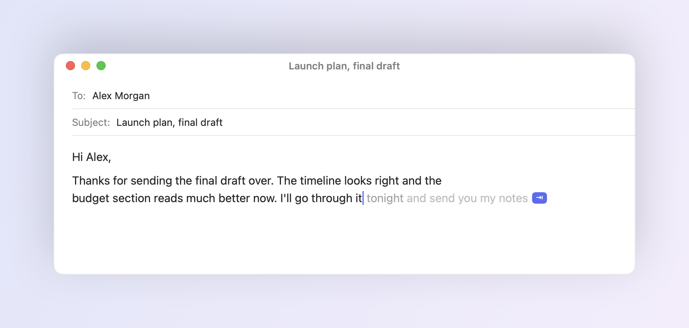
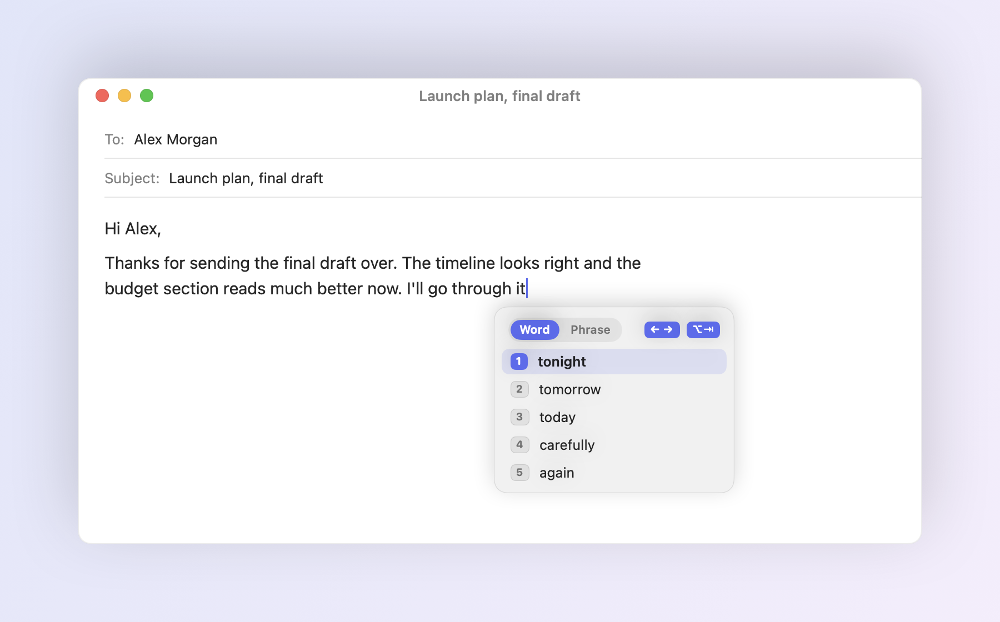
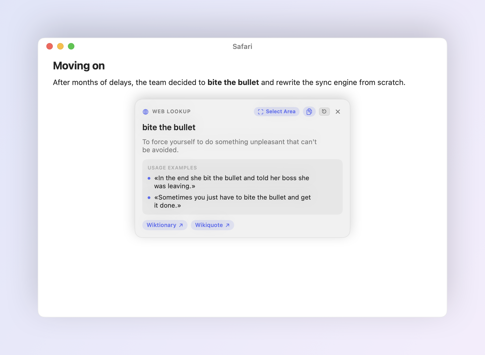
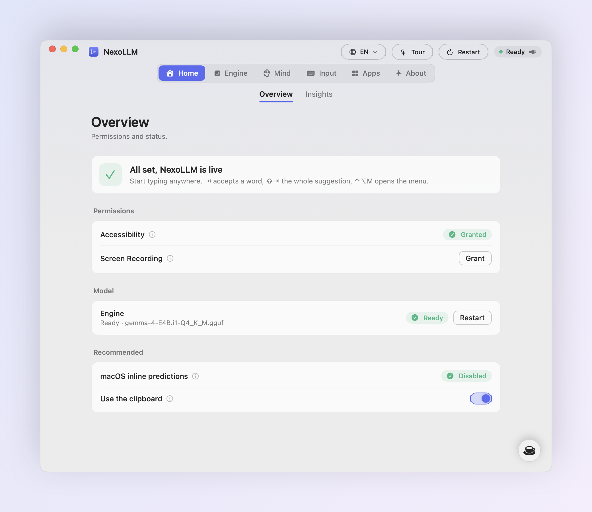
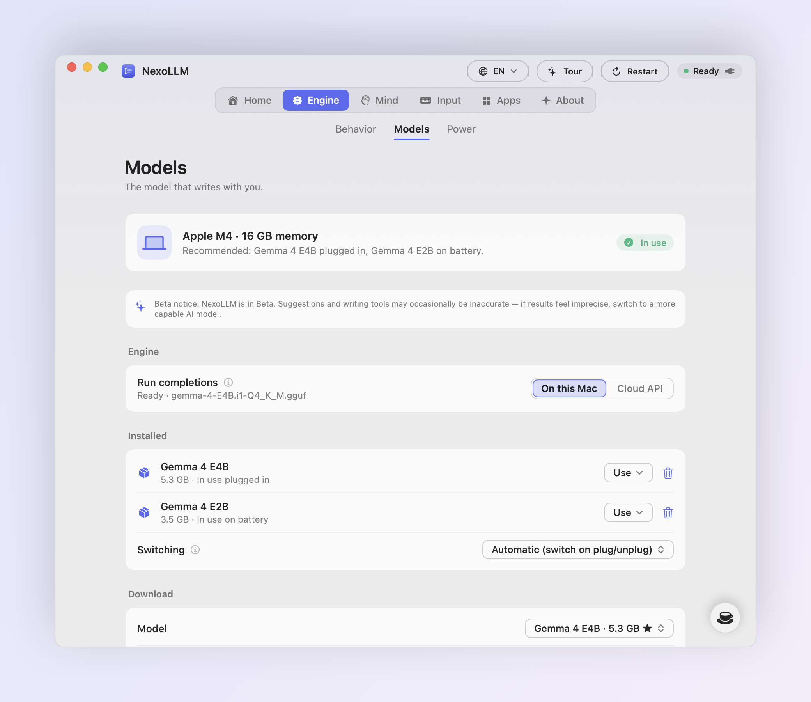
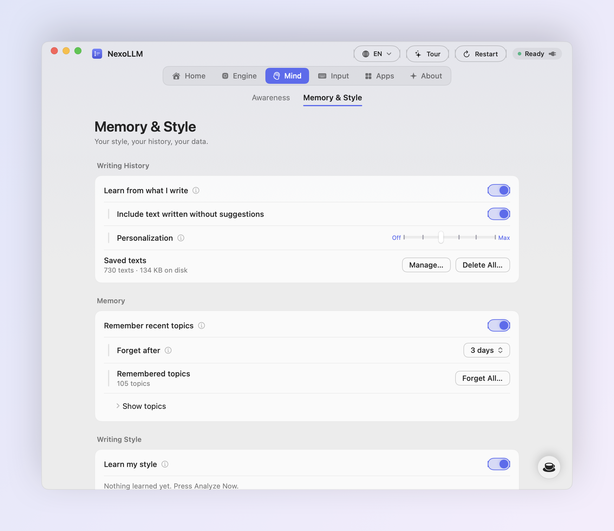

# NexoLLM

Autocomplete, writing tools and instant answers for every app on your Mac. 
Runs a local model on Apple Silicon, or the API you already pay for.

 

  

  

<picture>
  <source media="(prefers-color-scheme: dark)" srcset="assets/hero-dark.png">
  
</picture>

## What it does

NexoLLM sits in the menu bar and suggests the rest of your sentence, in grey, right after the cursor.
<kbd>Tab</kbd> takes the next word, the key above it takes the whole suggestion, and if you keep typing
it simply goes away. It works wherever you write: Mail, Messages, WhatsApp, Slack, Notes, Pages, Safari,
Chrome, Obsidian and most other apps.

It reads more than the line you're on. Names, dates and numbers in the subject or the recipient field
carry over into the body. What's on screen, and optionally what's being said in the room or in a call,
becomes context. Your past writing teaches it your tone, per app, and a short encrypted memory keeps track
of what you've been writing about lately.

 

<table>
<tr>
<td width="50%" valign="top">

**Words that make sense** 
Suggestions start from the half-typed word, so the obvious word is the one you get. Punctuation always
takes its own <kbd>Tab</kbd>, so you decide where a sentence ends. Typos get a one-key fix.

</td>
<td width="50%" valign="top">

**Other options, one key away** 
<kbd>⌥</kbd> <kbd>Tab</kbd> lists other words for the one you're typing. Press it again (or <kbd>←</kbd>
<kbd>→</kbd>) to see other ways to finish the sentence. Select a word to get synonyms.

</td>
</tr>
<tr>
<td valign="top">

**Writing tools** 
Improve, fix grammar, make formal, make shorter or translate the selection, or the paragraph you're
writing, in place. Your language is kept: Italian stays Italian, English stays English.

</td>
<td valign="top">

**Smart Web Lookup** 
Highlight anything, anywhere, and press <kbd>⌃</kbd> <kbd>⌥</kbd> <kbd>L</kbd>: a quick summary with
sources. Idioms get their real meaning, questions get the latest news.

</td>
</tr>
<tr>
<td valign="top">

**Local or cloud** 
Pick a model for your Mac and download it from Settings, or paste an OpenAI, Anthropic, Gemini or
OpenRouter key and use that instead.

</td>
<td valign="top">

**Out of the way** 
No floating buttons. The menu bar icon shows the status, and <kbd>⌃</kbd> <kbd>⌥</kbd> <kbd>M</kbd> opens
the menu right at the cursor, fully usable with the arrow keys.

</td>
</tr>
</table>

 

<picture>
  <source media="(prefers-color-scheme: dark)" srcset="assets/alternatives-dark.png">
  
</picture>

## Writing tools and the quick menu

<kbd>⌃</kbd> <kbd>⌥</kbd> <kbd>M</kbd> opens a menu at the cursor (or at the mouse when you're not in a text
field). Numbers pick an item, <kbd>→</kbd> opens a group, <kbd>⇧</kbd> + number picks inside it.

- **Writing Tools**: Improve Writing, Fix Grammar, Make Formal, Make Shorter, Translate (English, Italian,
  Spanish, French, German, Portuguese). With nothing selected they work on the paragraph you're writing.
- **Pause** in the current app or everywhere, for 10 minutes, 30 minutes, 2 hours or until you resume.
- **Smart Web Lookup**, **Read the Screen Now**, **Audio Context** (start, stop and language) and Restart.

<picture>
  <source media="(prefers-color-scheme: dark)" srcset="assets/quickmenu-dark.png">
  
</picture>

## Smart Web Lookup

Press <kbd>⌃</kbd> <kbd>⌥</kbd> <kbd>L</kbd>:

- **Text highlighted** in any app (a web page, a PDF, a chat): it's looked up right away.
- **Nothing highlighted**: a search bar opens. Type a question, or drag over any part of the screen to
  read the text there.

Typos are fixed before searching, sources follow the language you search in, idioms get their figurative
meaning with real usage examples, and questions about current events get the latest headlines with a
short summary. Every card links its sources and has a Copy button.

<picture>
  <source media="(prefers-color-scheme: dark)" srcset="assets/lookup-dark.png">
  
</picture>

## Context: screen and audio

<picture>
  <source media="(prefers-color-scheme: dark)" srcset="assets/settings-context-dark.png">
  
</picture>

- **Screen** (needs Screen Recording): read automatically at a few moments, or on <kbd>⌃</kbd> <kbd>⌥</kbd>
  <kbd>S</kbd>. NexoLLM reads every window on screen and keeps the parts that match what you're writing,
  so a book or a note open next to your chat counts too. The image is dropped as soon as the text is read.
- **Audio Context** (off by default): listens to the room and to call audio (Zoom, Meet, Teams, videos)
  and uses what's said as context. Built for lectures and meetings: it picks up a speaker a couple of
  meters away in an echoey room, and **Auto** switches between Italian and English when the speaker does.
  *High sensitivity* uses Apple's speech service; turn it off to keep all audio on your Mac.
- **Awareness** shows, live, what NexoLLM read from the screen and what it heard. The Privacy Inspector
  shows everything it holds in memory, with Clear Now.

## Install

1. Download [NexoLLM.dmg](https://github.com/edevscomp/NexoLLM/releases/latest/download/NexoLLM.dmg) and drag NexoLLM to Applications.
2. The beta isn't notarized yet. The first time, right-click the app and choose **Open** (or allow it in
   System Settings → Privacy & Security).
3. Allow **Accessibility** when asked. Screen Recording, Microphone and Speech Recognition are optional and
   only asked for when you turn on the features that need them.
4. Open **Settings → Engine → Models** and click **Use Recommended**. NexoLLM picks models that fit your Mac's memory and downloads them.

Requires macOS 14 or later on Apple Silicon. 8 GB of memory works, 16 GB is recommended.

<picture>
  <source media="(prefers-color-scheme: dark)" srcset="assets/settings-setup-dark.png">
  
</picture>

## Keys

| | |
|---|---|
| Accept the next word | <kbd>Tab</kbd> |
| Accept the whole suggestion | the key above <kbd>Tab</kbd> |
| Dismiss | <kbd>Esc</kbd> |
| Alternatives (press again to switch word / phrase) | <kbd>⌥</kbd> <kbd>Tab</kbd> |
| Open the menu at the cursor | <kbd>⌃</kbd> <kbd>⌥</kbd> <kbd>M</kbd> |
| Smart Web Lookup | <kbd>⌃</kbd> <kbd>⌥</kbd> <kbd>L</kbd> |
| Read the screen for context | <kbd>⌃</kbd> <kbd>⌥</kbd> <kbd>S</kbd> |
| Restart NexoLLM's services | <kbd>⌃</kbd> <kbd>⌥</kbd> <kbd>R</kbd> |
| Suggest now | <kbd>⌃</kbd> + the key above <kbd>Tab</kbd> |

All of them can be changed in Settings → Input.

## Models

<picture>
  <source media="(prefers-color-scheme: dark)" srcset="assets/settings-models-dark.png">
  
</picture>

NexoLLM checks your chip and memory and recommends a model for when you're plugged in and a lighter one
for battery. Downloads come straight from Hugging Face and are verified with SHA-256 before they're used.
You can also import any GGUF file, and delete models you don't need to get the space back. After a while
without typing the model is freed from memory and comes back on the next keystroke.

| Model | Size | Good for |
|---|---|---|
| Gemma 4 E4B | 5.3 GB | Best quality, 16 GB Macs |
| Gemma 4 E2B | 3.4 GB | Fast, battery, 8 GB Macs |
| Llama 3.2 3B | 2.0 GB | Smallest, English |

With a cloud key, suggestions come from the provider you choose. Keys stay in your Keychain.

## Your style and memory

<picture>
  <source media="(prefers-color-scheme: dark)" srcset="assets/settings-personalization-dark.png">
  
</picture>

NexoLLM learns how you write in each app from what you've written there, and keeps short notes about
recent topics that fade over days. Both are encrypted (AES-256-GCM, key in your Keychain), can be turned
off per app and cleared at any time.

## Privacy

With a local model nothing you write leaves your Mac: no account, no analytics. Web Lookup, Audio Context (with
High sensitivity) and the daily update check use the network only for what they do. Your writing history and
memory are encrypted with a key kept in the Keychain, password fields are never read, and neither are
passwords copied from a password manager. In cloud mode the text around the cursor goes to the provider you
picked, and only to them. Details in [PRIVACY.md](PRIVACY.md).

## Feedback

NexoLLM is in beta. If a suggestion is wrong or something breaks, [open an issue](https://github.com/edevscomp/NexoLLM/issues/new/choose)
and say which app you were in. Release notes are in the [changelog](CHANGELOG.md).

If NexoLLM saves you time, you can [buy me a coffee](https://buymeacoffee.com/edevs).

## License

Free to use. NexoLLM is proprietary software: the source code is not published, and redistributing or
modifying the app isn't allowed. See [LICENSE](LICENSE). It includes llama.cpp (MIT).

 
Made by EdevS

