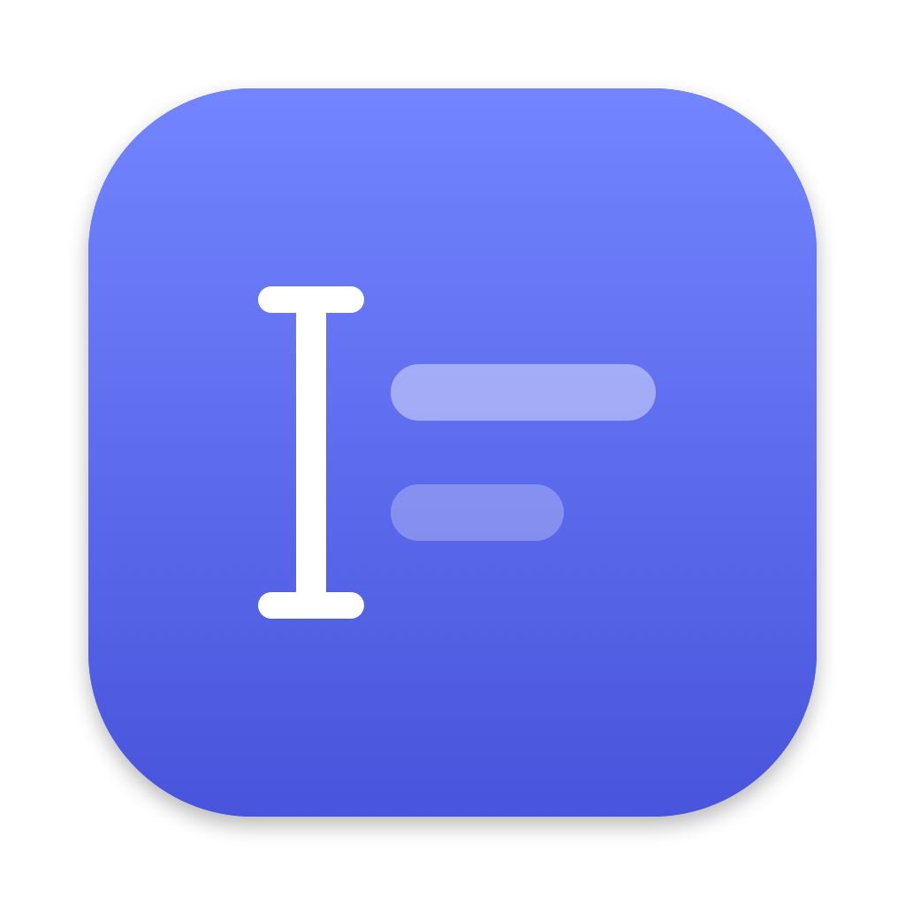
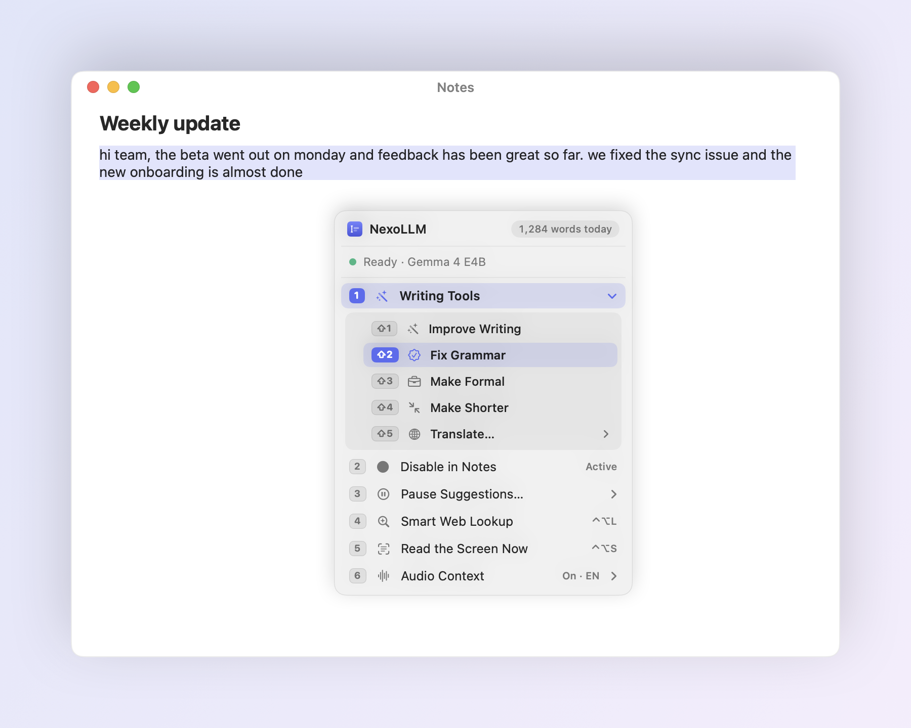
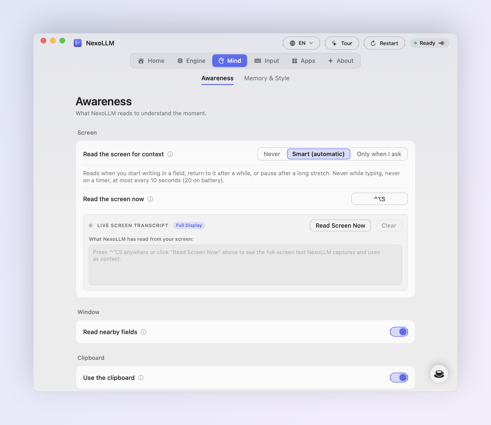
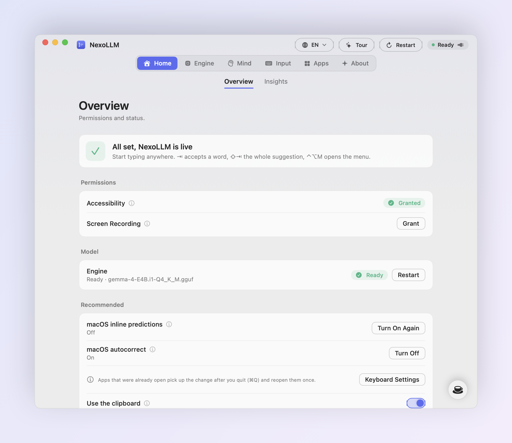
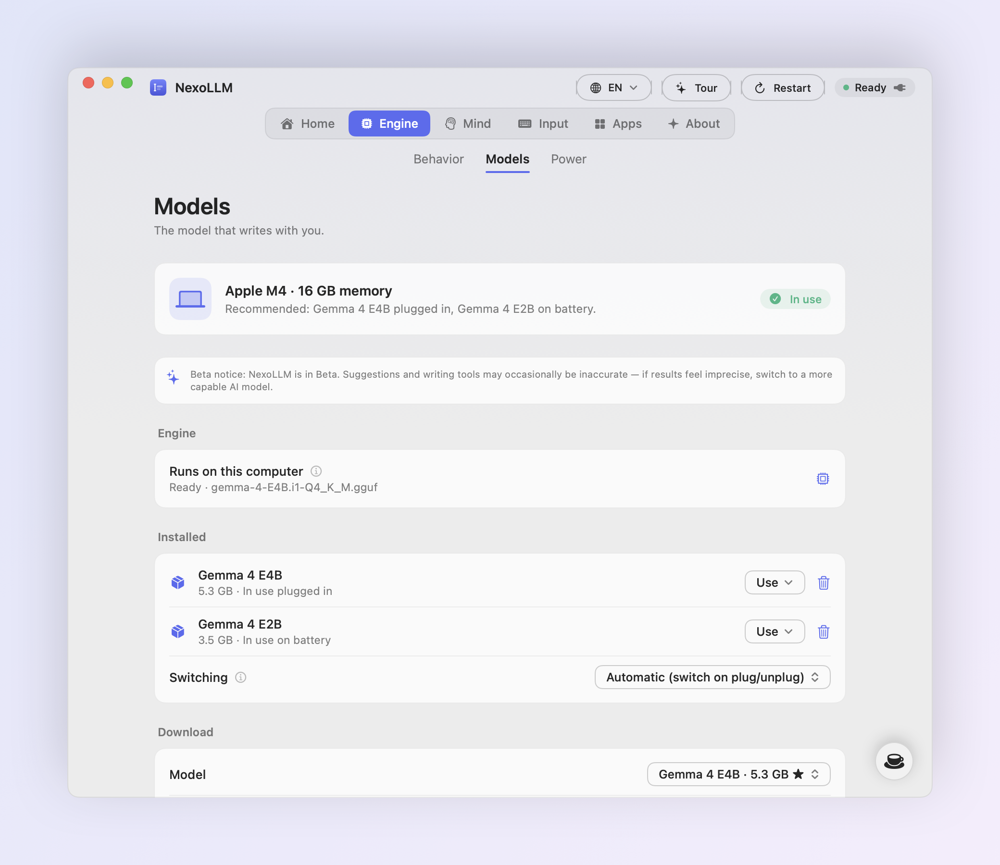

# NexoLLM

Autocomplete, writing tools and instant answers for every app on your computer. 
Free, open source, and 100% of the AI runs locally on your own hardware.

 

&nbsp;

  

  

<picture>
  <source media="(prefers-color-scheme: dark)" srcset="showcase/assets/hero-dark.png">
  
</picture>

## What it does

NexoLLM sits quietly in your system tray / menu bar and suggests the rest of your sentence, in grey, right after the cursor.
<kbd>Tab</kbd> takes the next word, <kbd>⇧</kbd> <kbd>Tab</kbd> takes the whole suggestion, and if you keep
typing it simply goes away. It works wherever you write: Mail, Outlook, Messages, WhatsApp, Slack, Discord, Notes, Word, Docs,
Chrome, Firefox, Edge, Obsidian and most other desktop apps.

It reads more than the line you're on. Names, dates and numbers in the subject or the recipient field carry
over into the body. What's on screen, and optionally what's being said in the room or in a call, becomes
context. Your past writing teaches it your tone, per app, and a short encrypted memory keeps track of what
you've been writing about lately.

**No subscription, no account, no paywall.** Every suggestion is computed by a language model running on your
computer's GPU and CPU. What you write is never sent to an AI service.

 

<table>
<tr>
<td width="50%" valign="top">

**Words that make sense** 
Suggestions start from the half-typed word, so the obvious word is the one you get. Punctuation always
takes its own <kbd>Tab</kbd>, so you decide where a sentence ends. Typos get a one-key fix.

</td>
<td width="50%" valign="top">

**Other options, one key away** 
<kbd>⌥</kbd> <kbd>Tab</kbd> lists other words for the one you're typing. Press it again (or <kbd>←</kbd>
<kbd>→</kbd>) to see other ways to finish the sentence. Select a word to get synonyms.

</td>
</tr>
<tr>
<td valign="top">

**Writing tools** 
Improve, fix grammar, make formal, make shorter or translate the selection, or the paragraph you're
writing, in place. Six active languages (`EN`, `IT`, `ES`, `FR`, `DE`, `PT`) with automatic language preservation.

</td>
<td valign="top">

**Smart Web Lookup** 
Highlight anything, anywhere, and press <kbd>⌃</kbd> <kbd>⌥</kbd> <kbd>L</kbd>: a quick summary with
sources. Idioms get their real meaning, questions get the latest news.

</td>
</tr>
<tr>
<td valign="top">

**Private by design** 
The model runs on your computer. History and memory are encrypted with AES-256, password fields are never read, and
nothing you write is ever sent to an AI service.

</td>
<td valign="top">

**Out of the way** 
No intrusive floating buttons. The tray / menu bar icon shows the status, and <kbd>⌃</kbd> <kbd>⌥</kbd> <kbd>M</kbd> opens
the quick menu right at the cursor, fully usable with the arrow keys.

</td>
</tr>
</table>

 

<picture>
  <source media="(prefers-color-scheme: dark)" srcset="showcase/assets/alternatives-dark.png">
  
</picture>

## Writing tools and the quick menu

<kbd>⌃</kbd> <kbd>⌥</kbd> <kbd>M</kbd> opens a menu at the cursor (or at the mouse pointer when you're not in a text
field). Numbers pick an item, <kbd>→</kbd> opens a group, <kbd>⇧</kbd> + number picks inside it.

- **Writing Tools**: Improve Writing, Fix Grammar, Make Formal, Make Shorter, Translate (English, Italian,
  Spanish, French, German, Portuguese). With nothing selected they work on the paragraph you're writing.
- **Pause** in the current app or everywhere, for 10 minutes, 30 minutes, 2 hours or until you resume.
- **Smart Web Lookup**, **Read the Screen**, **Audio Context** and **Restart**, all from the keyboard.

<picture>
  <source media="(prefers-color-scheme: dark)" srcset="showcase/assets/quickmenu-dark.png">
  
</picture>

## Smart Web Lookup

Press <kbd>⌃</kbd> <kbd>⌥</kbd> <kbd>L</kbd>:

- **Text highlighted** in any app (a web page, a PDF, a chat): it's looked up right away.
- **Nothing highlighted**: a search bar opens. Type a question, or drag over any part of the screen to
  read the text there.

Typos are fixed before searching, sources follow the language you search in, idioms get their figurative
meaning with real usage examples, and questions about current events get the latest headlines with a
short summary written on your computer. Every card links its sources and has a Copy button; click anywhere else
to close it. Web Lookup sends at most 300 characters to Wikipedia, Wiktionary, Wikiquote, DuckDuckGo and
Google News, only when you press the shortcut, and can be turned off in Settings → Engine → Behavior.

<picture>
  <source media="(prefers-color-scheme: dark)" srcset="showcase/assets/lookup-dark.png">
  
</picture>

## Context: screen and audio

<picture>
  <source media="(prefers-color-scheme: dark)" srcset="showcase/assets/settings-context-dark.png">
  
</picture>

- **Screen**: in *Smart* mode NexoLLM reads the screen at a few moments (when you start writing in a field,
  come back to it, or pause after a long stretch), never on a timer; or press <kbd>⌃</kbd> <kbd>⌥</kbd>
  <kbd>S</kbd>. Text is recognized on your computer and the image is dropped as soon as it's read.
- **Audio Context** *(optional plugin, experimental)*: listens to the room and to call audio (Zoom, Meet,
  Teams, videos) and uses what's said as context. Built for lectures and meetings: a far-field filter picks
  up a speaker a couple of meters away in an echoey room, and 6 languages (`EN`, `IT`, `ES`, `FR`, `DE`, `PT`)
  are detected automatically on every phrase or selectable individually.
  Speech is transcribed by **Whisper on your computer**: no audio or text leaves it, audio is never saved. The
  plugin isn't installed with the app: you add it from Settings → Mind → Awareness after reading the
  [legal notice](LEGAL_AUDIO_PLUGIN.md), and can remove it at any time.
- **Privacy Inspector** shows everything NexoLLM holds in memory, with Clear Now.

## Download & Install

<table>
<tr>
<td width="33%" valign="top">

### Desktop Installer (`.dmg` / `.zip`)
1. Download [**NexoLLM.dmg**](https://github.com/edevscomp/NexoLLM/releases/latest/download/NexoLLM.dmg) from [Releases](https://github.com/edevscomp/NexoLLM/releases/latest).
2. Open the installer and drag **NexoLLM** into **Applications**.
3. Grant **Accessibility** access when prompted.

</td>
<td width="33%" valign="top">

### Windows 10 / 11 (64-bit)
1. Download `NexoLLM-Setup-x64.msi` or `.exe` from the [Download Hub](docs/download/index.html) / [Releases](https://github.com/edevscomp/NexoLLM/releases/latest).
2. Run the installer or build via `platforms/scripts/build-windows.ps1`.
3. Accelerated via DirectML, Vulkan or CUDA.

</td>
<td width="33%" valign="top">

### Linux (64-bit)
1. Download `NexoLLM-x86_64.AppImage`, `.deb` or `.rpm` from the [Download Hub](docs/download/index.html) / [Releases](https://github.com/edevscomp/NexoLLM/releases/latest).
2. Enable AT-SPI2 / input access when prompted, or build via `platforms/scripts/build-linux.sh`.
3. Accelerated via Vulkan, ROCm or CUDA.

</td>
</tr>
</table>

1. On first launch, the interactive welcome tour recommends a local AI model tailored to your computer's memory and downloads it automatically.
2. Screen capture and Microphone are optional and only requested if you enable the features that use them.

Requires a 64-bit computer. 8 GB of RAM works, 16 GB is recommended.
Prefer to build it yourself? See [docs/BUILDING.md](docs/BUILDING.md) and [docs/MULTIPLATFORM.md](docs/MULTIPLATFORM.md).

<picture>
  <source media="(prefers-color-scheme: dark)" srcset="showcase/assets/settings-setup-dark.png">
  
</picture>

## Keys

| | |
|---|---|
| Accept the next word | <kbd>Tab</kbd> |
| Accept the whole suggestion | <kbd>⇧</kbd> <kbd>Tab</kbd> |
| Dismiss | <kbd>Esc</kbd> |
| Alternatives (press again to switch word / phrase) | <kbd>⌥</kbd> <kbd>Tab</kbd> |
| Open the menu at the cursor | <kbd>⌃</kbd> <kbd>⌥</kbd> <kbd>M</kbd> |
| Smart Web Lookup | <kbd>⌃</kbd> <kbd>⌥</kbd> <kbd>L</kbd> |
| Read the screen for context | <kbd>⌃</kbd> <kbd>⌥</kbd> <kbd>S</kbd> |
| Restart NexoLLM's services | <kbd>⌃</kbd> <kbd>⌥</kbd> <kbd>R</kbd> |
| Suggest now | <kbd>⌃</kbd> + the key above <kbd>Tab</kbd> |

All of them can be changed in Settings → Input.

## Models

<picture>
  <source media="(prefers-color-scheme: dark)" srcset="showcase/assets/settings-models-dark.png">
  
</picture>

NexoLLM checks your processor, GPU and memory and recommends a model for when you're plugged in and a lighter one
for battery. Downloads come straight from Hugging Face and are verified with SHA-256 before they're used.
You can also import any GGUF file, and delete models you don't need to get the space back. After a while
without typing the model is freed from memory and comes back on the next keystroke.

| Model | Size | Good for |
|---|---|---|
| Gemma 4 E4B | 5.3 GB | Best quality, 16 GB RAM computers |
| Gemma 4 E2B | 3.4 GB | Fast, battery, 8 GB RAM computers |
| Qwen 2.5 7B / 3B | 4.7 / 1.9 GB | Many languages |
| Llama 3.2 3B / 1B | 2.0 / 0.8 GB | Lightest, English first |

## Your style and memory

<picture>
  <source media="(prefers-color-scheme: dark)" srcset="showcase/assets/settings-personalization-dark.png">
  
</picture>

NexoLLM learns how you write in each app from what you've written there, and keeps short notes about
recent topics that fade over days. Both are encrypted (AES-256-GCM, key stored in your system credential store), can be turned
off per app and cleared at any time.

## Privacy and security

- **AI on your computer.** Suggestions, writing tools, translations, summaries, screen reading and the audio
  plugin all run locally. No account, no analytics, nothing you write is sent to an AI service.
- **The network, only for what you ask.** Model and plugin downloads you start, a daily check for signed
  updates on GitHub, and Web Lookup when you press its shortcut. Both can be turned off.
- **Signed updates.** Every release is signed with an Ed25519 key; the app checks the signature of the
  version and its SHA-256 before opening anything, so a tampered or swapped download is deleted.
- **Encrypted, owner-only data.** History and memory use AES-256-GCM with a key in your system credential store; password
  fields and password-manager copies are never read.

Details: [PRIVACY.md](PRIVACY.md) · [SECURITY.md](SECURITY.md) · [Audio plugin legal notice](LEGAL_AUDIO_PLUGIN.md)

## Feedback and contributions

NexoLLM is in early-stage development: while built for reliable everyday writing, occasional rough edges or imprecise suggestions may still occur. If something breaks, [open an issue](https://github.com/edevscomp/NexoLLM/issues/new/choose)
and say which app you were in. Pull requests are welcome: see [docs/BUILDING.md](docs/BUILDING.md) and [docs/MULTIPLATFORM.md](docs/MULTIPLATFORM.md). Release
notes are in the [changelog](CHANGELOG.md).

If NexoLLM saves you time, you can [buy me a coffee](https://buymeacoffee.com/edevs).

## License

NexoLLM is free software: you can redistribute it and/or modify it under the terms of the
[GNU General Public License v3.0](LICENSE). The names "NexoLLM" and "EdevS" and the icon identify the official
builds: see [TRADEMARKS.md](TRADEMARKS.md). It includes llama.cpp and whisper.cpp (MIT).

 
Made by EdevS · © 2026

